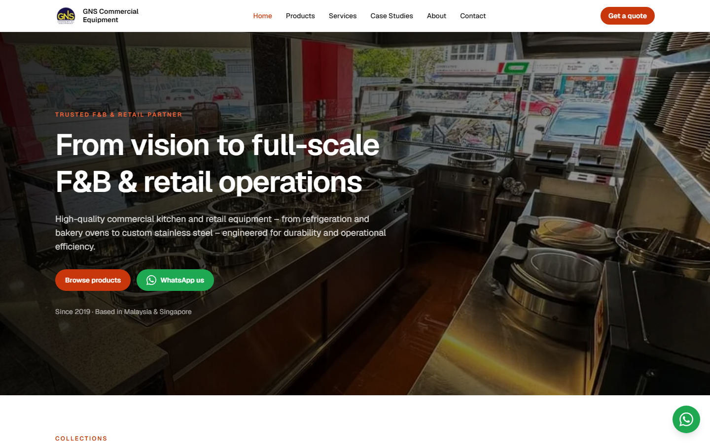
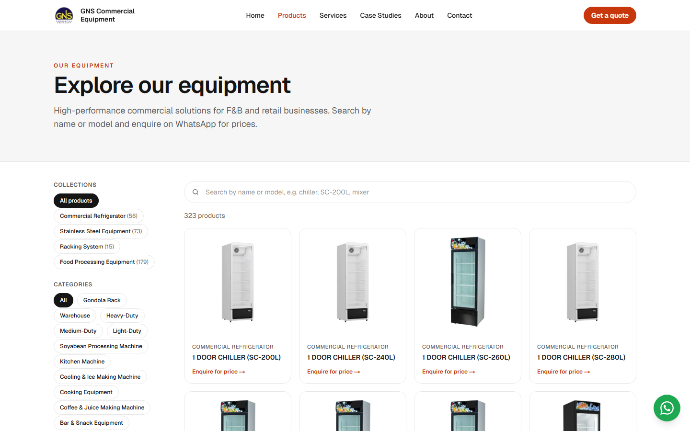
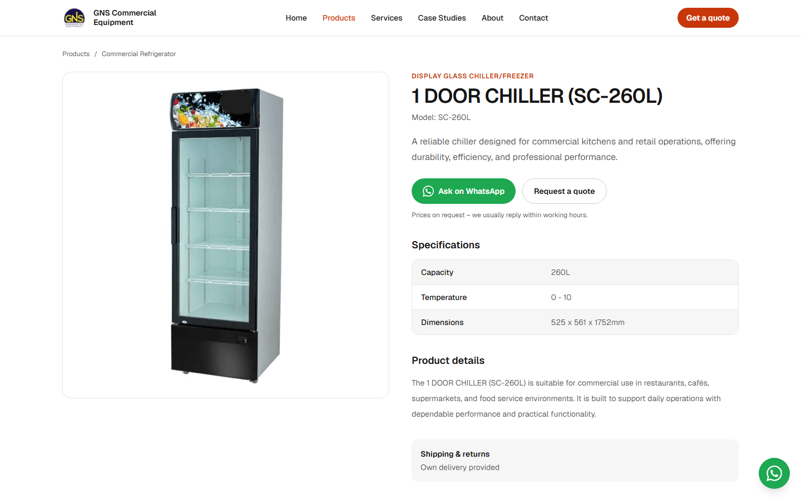
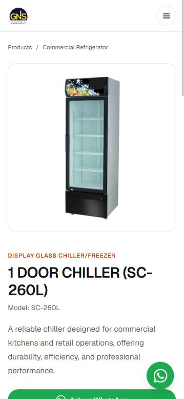

# GNS Commercial Equipment – Website

A custom website for **GNS Commercial Equipment**, a commercial kitchen and retail equipment supplier in Johor, Malaysia. It replaced the company's old Framer site with a fast, searchable product catalogue that the team can update without touching code.

**Live site: [www.gnscommercial.my](https://www.gnscommercial.my)**



## At a glance

- **335 products in 5 collections**: 323 moved automatically from the old site (photos, specs, categories), plus a new Ice Maker range the team added later through the CMS
- **Product search and filters** – search by name or model number (e.g. "SC-260L"), filter by collection and category
- **"Ask on WhatsApp"** on every product, with the product name already filled in
- **Contact form** that emails enquiries to the team, with server-side validation and spam protection
- **Content dashboard (Sanity CMS)** at `/studio` for products, services, case studies and company details
- **Old links still work** – every old Framer URL redirects to its new page (301)
- **Built for Google and sharing** – sitemap (344 URLs), product structured data, business details, and link previews for WhatsApp/LinkedIn
- **Branches** for Johor Bahru, Singapore and Kuala Lumpur on the contact page, each with a map, numbers, hours and its own WhatsApp button, all edited in the CMS
- **Mobile-first** design

| Products | Product page | On a phone |
|---|---|---|
|  |  |  |

## Tech stack

| Part | Tool |
|---|---|
| Framework | [Next.js 16](https://nextjs.org) (App Router, TypeScript, Cache Components) |
| Styling | Tailwind CSS v4 |
| Content | [Sanity](https://www.sanity.io) – Studio embedded at `/studio` |
| Hosting | [Netlify](https://www.netlify.com) – deploys automatically on every push |
| Email | [Resend](https://resend.com) – contact-form enquiries from a verified domain |
| SEO | Google Search Console, `sitemap.xml`, JSON-LD (Product, LocalBusiness) |

The whole stack runs on free plans – the only running cost is the domain.

## How it was built

1. **Scraped the old Framer site** (`scripts/scrape-framer*.mjs`) – products, specs, categories, services and case studies – and cleaned up the data (split joined-up spec labels, removed duplicates, fixed model codes).
2. **Imported everything into Sanity** (`scripts/import-*.mjs`), including images, so nothing had to be copied by hand.
3. **Built the pages** with Next.js: home, products with search and filters, product pages, services, case studies, about and contact.
4. **Kept every old URL working** with redirects (`data/framer/redirects.json` + `next.config.ts`).
5. **Launched** on Netlify with a custom `.my` domain, HTTPS, a verified email domain and Google Search Console.

I built it with **[Claude Code](https://claude.com/claude-code)** as my AI pair-programmer. My job was planning the project, guiding the AI, reviewing and testing its code, and handling the client side – `CLAUDE.md` holds the project rules the AI follows.

## Updates since launch

The site is looked after on a monthly basis. Changes so far:

- **Nov 2026:** new Ice Maker collection (12 new machines plus 3 moved in, with four ice-type filters), a Branches section (JB, Singapore, KL) with maps and per-branch WhatsApp, updated opening hours, and a 5-column collection grid on the home page. Product and branch data are added in Sanity, so most updates go live without a code change.

## Project structure

```
app/            Pages (App Router) – (site)/ for the public site, studio/ for the CMS
components/     UI pieces: header, footer, product card, search, gallery…
sanity/         Sanity config, content schemas, cached data queries
scripts/        One-time scraping and import scripts used for the migration
lib/            Small helpers (site URL, WhatsApp links)
```

## Run it locally

1. Install packages: `npm install`
2. Copy `.env.example` to `.env.local` and fill in your own Sanity project ID (and a Resend key if you want the contact form to send)
3. Start: `npm run dev`
4. Website: http://localhost:3000 · CMS: http://localhost:3000/studio

You'll need your own Sanity project with content – the client's content isn't included in this repo.

## Credits

Built by **Githan Raj** – Software Engineering student at UMPSA, freelance web developer.

The code is shared here as a portfolio piece. The GNS name, logo, photos and product content belong to GNS Commercial Equipment and are not licensed for reuse.
